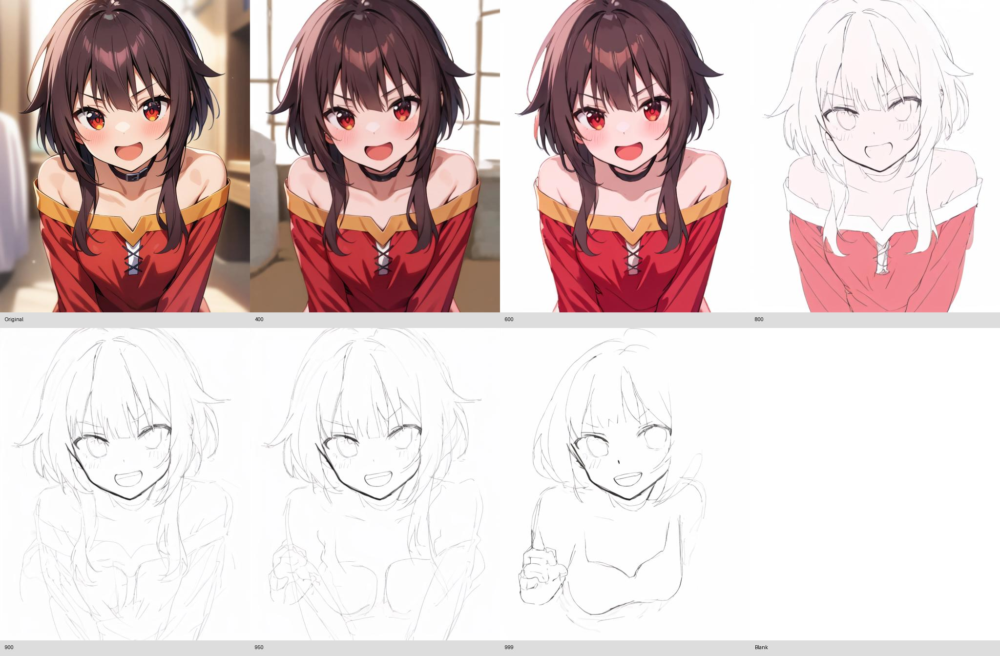

# ZZX Nodes — Paints-Undo for ComfyUI

把成图逐步撤销为少上色、线稿、少笔画的关键帧序列。使用原版 Paints-Undo 模型推理，不是褪色或擦除滤镜。



## 安装

在 ComfyUI 的 `custom_nodes` 目录克隆本仓库，然后使用 **运行 ComfyUI 的 Python** 安装根目录依赖并重启：

```sh
git clone https://github.com/ZZXYWQ/ComfyUI-ZZXYWQ.git
python -m pip install -r ComfyUI-ZZXYWQ/requirements.txt
```

Windows portable 在其根目录执行：

```bat
python_embeded\python.exe -m pip install -r ComfyUI\custom_nodes\ComfyUI-ZZXYWQ\requirements.txt
```

不需要安装 `Paints-UNDO/requirements.txt`；该文件只供保留的上游 Gradio/视频实验代码使用。节点主流程不依赖 Gradio、xformers、bitsandbytes、PEFT 或视频模型。

## 使用

导入 `workflows/workflow-PaintsUndoSequence.json`，在 Load Image 选择自己的图片，然后运行：

`Load Image → ZZX_PaintsUndoSequence → Save Image / Preview Image`

- `prompt`：留空自动调用原版 WD14 MOAT tagger，推荐这样使用；也可输入已有标签。
- `operations`：严格递增的撤销位置，默认 `400,600,800,900,950,999`。0 是原图，999 接近最早的笔画。它不是采样步数。
- `sampling_steps`：默认 50；示例使用 30。
- `cfg`：默认 3.0，与上游关键帧配置一致。
- `resolution`：最长边，默认 640；宽高按比例取整为 64 的倍数，不裁切画面。
- `include_original` / `include_blank`：添加首张原图和末张白纸。白纸是合成终帧，不是模型推理结果。
- `seed`：各个撤销位置共享初始噪声，以提高帧间一致性。

输出是标准 ComfyUI `IMAGE` 批次 `[帧数, 高, 宽, 3]`，float32、RGB、0–1。也可连接你已有的视频保存节点制作逐帧动画。这个精简节点输出关键帧，并未加载上游耗显存的多帧视频插值模型。

旧 `ZZX_PaintsUndo` 节点名、输入和输出接口保留，现在正确返回单张图片。一次只接收一张 RGB 输入；多图批次会明确报错，避免静默丢失图片。

模型模拟绘画过程，并不能恢复原画真实的图层历史。上色和笔画变化的位置取决于图片与模型；它不保证每一步严格只减不增，某些细节会重绘。可调整 operations 和 seed。

## 接入其他项目 / HTTP API

`workflows/paints_undo_api.json` 是可提交到 ComfyUI `/prompt` 的 API 格式；`workflow-PaintsUndoSequence.json` 是拖入界面的可视工作流，两者用途不同。

1. 将图片通过 ComfyUI `POST /upload/image` 上传，使用返回的文件名替换 API JSON 节点 `1.inputs.image`（如有子目录，带上子目录）。
2. 修改节点 `2.inputs` 中的 operations、seed 等参数。
3. 将 JSON 包装为 `{"prompt": <API JSON>}`，POST 到 `/prompt`。
4. 用返回的 `prompt_id` 查询 `/history/{prompt_id}`；完成后从节点 `3` 的 outputs.images 读取 filename/subfolder/type，并通过 `/view` 获取图片。

输出图片按撤销顺序排列。默认 6 个撤销位置加原图、白纸共 8 帧；旧节点只有 1 帧。API 示例的 `paints_undo_example.jpg` 是占位文件名，需先上传图片或复制 `Paints-UNDO/imgs/1.jpg` 到 ComfyUI/input 并改成该名字。

## 模型与资源

首次运行自动下载 `lllyasviel/paints_undo_single_frame` 和 WD14 MOAT tagger，总计数 GB，需要网络。缓存默认在 `ComfyUI/models/paints_undo`，不修改全局 HF_HOME。

可设置环境变量 `PAINTS_UNDO_MODEL_DIR` 指定缓存目录；也可将完整单帧模型（tokenizer、text_encoder、vae、unet 子目录）放到该目录下的 `single_frame/`。已缓存后可以离线运行。

模型按 VAE → CLIP → UNet → VAE 分阶段移入显卡，每次只生成一帧，完成或失败后卸载。VAE 使用 float32 避免半精度溢出导致黑图。支持 CUDA；无 CUDA 时回退 CPU（速度较慢）。其他加速后端尚未验证。

## 验证与开发

```sh
python -m unittest discover -s tests -v
python scripts/render_example.py
```

第二条命令运行真实模型，生成 PNG 帧、GIF 和对比图到 `outputs/`。第一次运行会下载模型。详见 [测试记录](TESTING.md)。

## 上游

模型及核心采样/条件模块来自 [lllyasviel/Paints-UNDO](https://github.com/lllyasviel/Paints-UNDO)，上游许可证保留于 `Paints-UNDO/LICENSE`。原版 Gradio 和视频源码保留以便参考，但不会在节点加载时导入。

## 其他原有工具

2.StreamRecorder
==
A streaming media receives a local recording node:
Streaming formats available: rtmp, .m3u8.
Optional formats: mp4, mov, mkv, avi.
Optional encoding: av1, h264, h265.
Optional: whether to use local time,If yes, then this start_time takes effect, the time inside is hours/minutes/seconds.
Optional: recording time (slider).
Optional: whether to use cuda.


一个流媒体收到录本地的节点：
可输入流媒体格式：rtmp，.m3u8。
可选格式：mp4，mov，mkv，avi。
可选编码：av1，h264，h265。
可选:是否使用本地时间，
     如果是，则这start_time生效，里面的时间是时/分/秒。
可选:录制时间（滑块）。
可选:是否使用cuda。

AVI (avi): h264

MOV (mov): h264, hevc

MKV (mkv): av1, h264, hevc

MP4 (mp4): av1, h264, hevc

HLS (hls): av1, h264, hevc

DASH (dash): av1, h264, hevc

MSS (mss): av1, h264, hevc

SRT (srt): h264, hevc

FLV (flv): h264

WebM (webm): av1, h264

RTMP (rtmp): h264

RTSP (rtsp): h264, hevc

M3U8 (m3u8): av1, h264, hevc

1.VideoFormatConverter：
==
A video transcoding node:
Optional formats: mp4, mov, mkv, avi.
Optional encoding: av1, h264, h265.
Optional frame rate: 8, 15, 24, 25, 30, 50, 59, 60, 120.
Optional width and height: (not listed one by one).
Optional audio: mp3, aac.
Optional frequency: 44100, 48000.

一个视频转码的节点：
可选格式：mp4，mov，mkv，avi。
可选编码：av1，h264，h265。
可选帧率：8，15，24，25，30，50，59，60，120。
可选宽高：（不一一列举）。
可选音频：mp3，aac。
可选频率：44100，48000。


welcome
==
Options can be added to the above nodes,
Please give feedback if you have any questions

以上节点均可添加选项，
有问题请反馈
